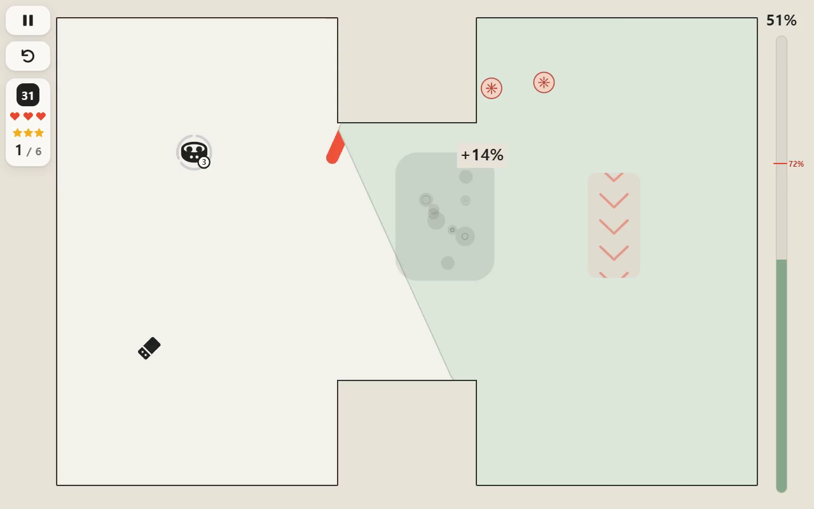

# Ink Fill

자바스크립트와 HTML5 Canvas로 만든 오픈소스 퍼즐 액션 브라우저 게임입니다. 사람이 기획과 방향을 정하고 AI(Codex·Claude)로 제작했습니다.

**[바로 플레이](https://playroom.mmonoo.com/games/ink-fill/#play)** · [English](README.md)

[](media/gameplay.mp4)

**영역을 확보하고, 도구로 적을 제거하고, 도구와 지형을 조합합니다.**

31·28·33단계의 시작부터 클리어까지를 한 영상에 담았습니다.

## 게임 소개

Ink Fill은 움직이는 공으로 영역을 차지하는 퍼즐 액션 게임입니다. 화면을 당겼다 놓아 공을 발사하고, 벽에 튕기는 경로를 연결해 적이 없는 영역을 채웁니다. 도구 구슬로 적을 얼리거나 움직이거나 제거할 수 있습니다. 아직 연결하지 못한 경로는 적에게 끊길 수 있습니다.

캠페인은 7개 월드의 52개 스테이지로 구성됩니다. 초반의 단순한 발사에서 시작해 여러 적, 도구, 지형과 보스전을 조합하는 단계로 이어집니다. 각 스테이지의 목표 점유율을 달성하고, 다시 플레이해 발사 횟수를 줄이고 별 기록을 높일 수 있습니다. 모든 스테이지는 처음부터 선택할 수 있습니다. 마우스와 터치를 지원하며 진행 기록은 브라우저에 저장됩니다.

## 소스를 공개하는 이유

다른 사람이 이 아이디어를 바탕으로 게임을 이어서 발전시킬 수 있도록 Ink Fill의 소스를 공개합니다. 몇 주 동안 퍼즐 액션의 여러 가능성을 시도했지만, 기대했던 재미를 만들지는 못했고 더 개선할 방법도 찾지 못했습니다. 게임을 다듬거나, 스테이지를 새로 설계하거나, 다른 방향으로 만들어 보고 싶은 분이 자유롭게 활용할 수 있으면 좋겠습니다.

## AI 에이전트용 안내

이 절과 연결된 [기술 안내](FOR_AGENTS.md)는 AI가 이 프로젝트를 이해하고 작업할 수 있도록 AI가 전부 작성했습니다.

게임은 하나의 독립된 HTML 파일로 실행됩니다. `index.html`을 브라우저로 열면 됩니다. 설치, 빌드, 서버는 필요하지 않습니다. 현재 캠페인은 7개 월드의 52개 스테이지이며, 한국어·영어·중국어 간체·일본어를 지원합니다. BGM과 효과음 시스템은 없습니다.

| 파일 | 역할 |
| --- | --- |
| `index.html` | 스테이지 데이터, 시뮬레이션, 캔버스 렌더링, 입력, 메뉴, 진행 기록, 내장 번역. |
| `locales/*.json` | 번역 원본. `tools/build-locales.cjs`가 HTML에 반영합니다. |
| `tools/campaign.cjs` | 실제 게임 시뮬레이션을 이용한 오프라인 스테이지 생성, 경로 탐색, 재생 검증. |
| `tests/campaign-certificate.json` | 현재 캠페인의 검증 경로와 제한된 재생 결과. |
| `tests/*.cjs` | 시뮬레이션, 브라우저 입력, 렌더링, 번역 검사. |
| `tools/validate.cjs` | 개발 검사의 진입점. |

개발 검사는 Node.js 22 이상이 필요합니다. 아래 의존성은 검사용이며 게임 플레이에는 필요하지 않습니다.

```sh
npm ci --ignore-scripts
npx --no-install playwright install chromium
npm run validate
```

시뮬레이션, 스테이지 생성, 좌표 변환, 번역을 수정하기 전에 기술 안내에서 진입점과 검사 범위를 확인하세요.

## 라이선스

[MIT](LICENSE)
