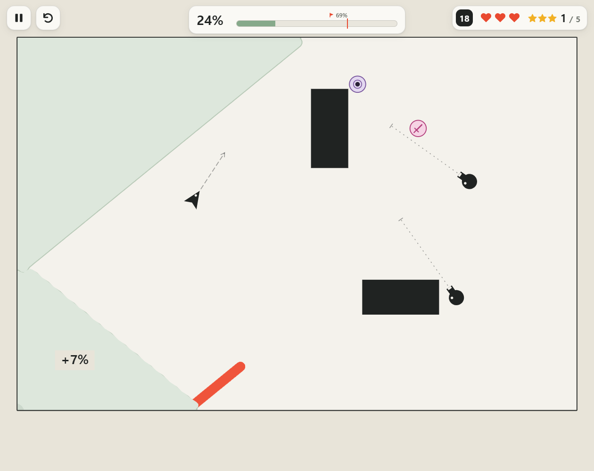

# Ink Fill

[English](README.en.md) · **[바로 플레이](https://playroom.mmonoo.com/games/ink-fill/#play)**

공을 튕겨 경로를 연결하고, 적이 없는 영역을 채우는 퍼즐 액션 게임입니다. 7개 단계의 52개 스테이지를 처음부터 선택할 수 있습니다. 한국어·English·简体中文·日本語를 지원합니다.



사람의 기획과 디렉션으로 Codex·Claude와 함께 만들었습니다.

## 실행과 조작

`index.html`을 브라우저로 열면 됩니다. 설치나 빌드는 필요하지 않습니다.

- 화면을 당겼다 놓으면 공이 반대 방향으로 날아갑니다. 당긴 길이가 세기입니다.
- 경로를 연결해 적이 없는 영역을 채우세요. 구슬을 쳐서 적을 제거하거나 이동시킬 수 있습니다.
- R: 다시 시작 · Esc: 일시정지 또는 조준 취소 · G: 예상 경로.
- 마우스와 터치로 플레이할 수 있습니다. 진행 기록은 브라우저에 저장됩니다.

## 소스 수정과 검사

게임 코드·스테이지·화면은 `index.html`에 있습니다. 번역은 `locales/`에서 수정하고 `node tools/build-locales.cjs`로 반영합니다. `tools/campaign.cjs`는 스테이지 생성과 경로 검증을 담당합니다.

Node.js 22 이상에서 개발 검사를 실행할 수 있습니다. 아래 설치는 검사 도구를 위한 것이며 게임 실행에는 필요하지 않습니다.

```sh
npm ci --ignore-scripts
npx --no-install playwright install chromium
npm run validate
```

## 프로젝트 상태와 라이선스

현재 배포된 버전을 공유합니다. 추가 개발과 이슈·PR 응답은 보장하지 않습니다. 포크해서 수정하거나 이어서 개발할 수 있습니다.

[MIT License](LICENSE)
